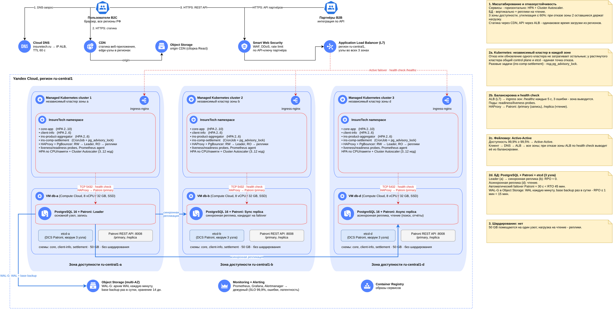

# Task1 - Технологическая архитектура to-be

- [`InureTech_технологическая_архитектура_to-be.drawio`](./InureTech_технологическая_архитектура_to-be.drawio) - схема

| Вопрос | Решение |
|---|---|
| Масштабирование | Сервисы - горизонтально (HPA + Cluster Autoscaler), БД - вертикально + реплики на чтение |
| Зоны | 3 зоны доступности ru-central1 |
| Kubernetes | Независимый кластер в каждой зоне |
| Балансировка | DNS -> ALB (L7), health check ingress каждой зоны; CDN для статики |
| Фейловер | Active-Active (99,9% >= 99,5%) |
| БД | PostgreSQL + Patroni + etcd: Leader, синхронная и асинхронная реплики; WAL-G в Object Storage |
| Шардирование | Нет |

