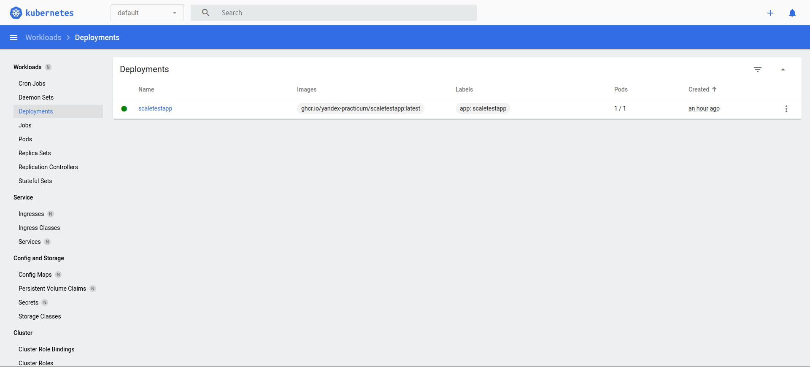
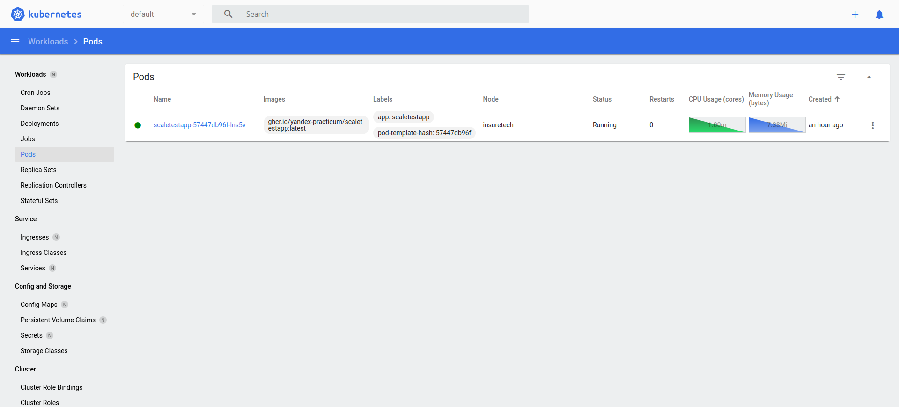
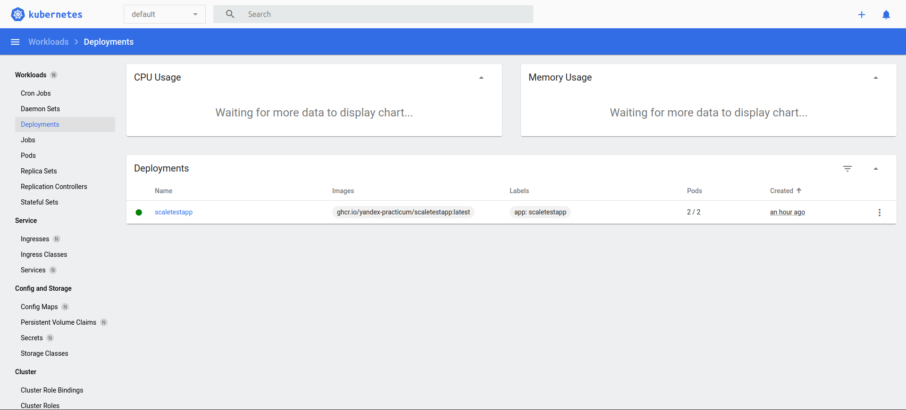
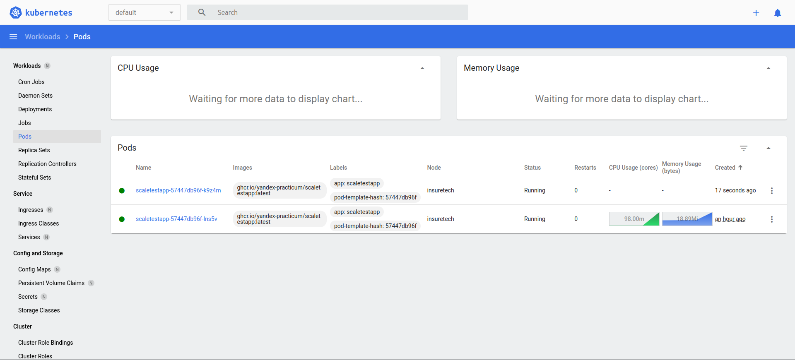
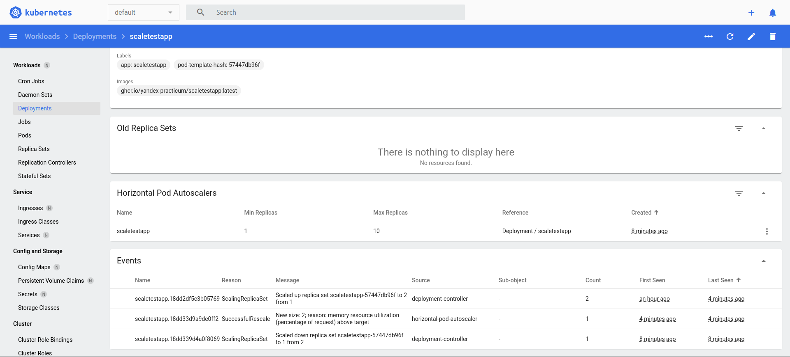
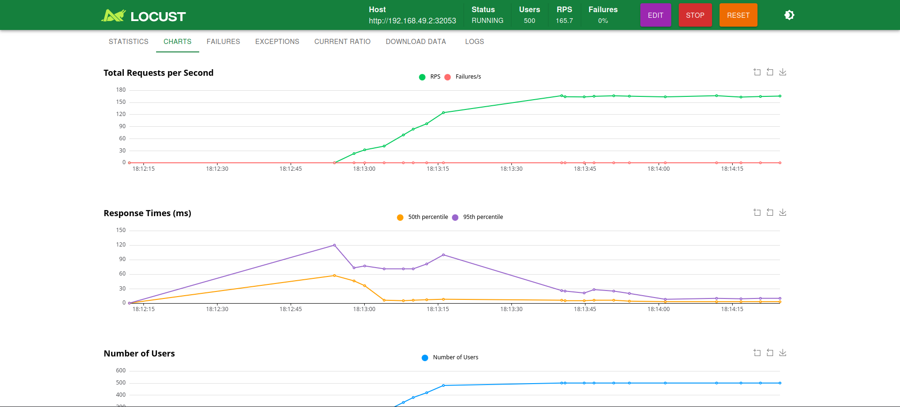

# Task2 - Динамическое масштабирование контейнеров

- [`deployment.yaml`](./deployment.yaml) - Deployment
- [`service.yaml`](./service.yaml) - Service
- [`hpa.yaml`](./hpa.yaml) - Horizontal Pod Autoscaler
- [`locustfile.py`](./locustfile.py) - сценарий нагрузки
- [`results/`](./results) - логи
- [`screenshots/`](./screenshots) - дашборд и locust

```bash
minikube addons enable metrics-server
kubectl apply -f deployment.yaml -f service.yaml -f hpa.yaml
locust -f locustfile.py --host "$(minikube service scaletestapp --url)"
```

Стресс-тест: 500 пользователей, 20 в секунду, 6 минут.

Результат (`results/hpa-watch.log`, `results/hpa-describe.log`):

```
16:25:08 memory: 49%/80%  replicas 1
16:26:02 memory: 109%/80% replicas 1
16:26:23 memory: 109%/80% replicas 2   SuccessfulRescale: New size: 2
```

Память выше 80% - HPA добавил реплику; ошибок 0, перезапусков подов 0.

До нагрузки - 1 под:




Под нагрузкой - 2 пода:




HPA и события масштабирования:



Нагрузка locust:


