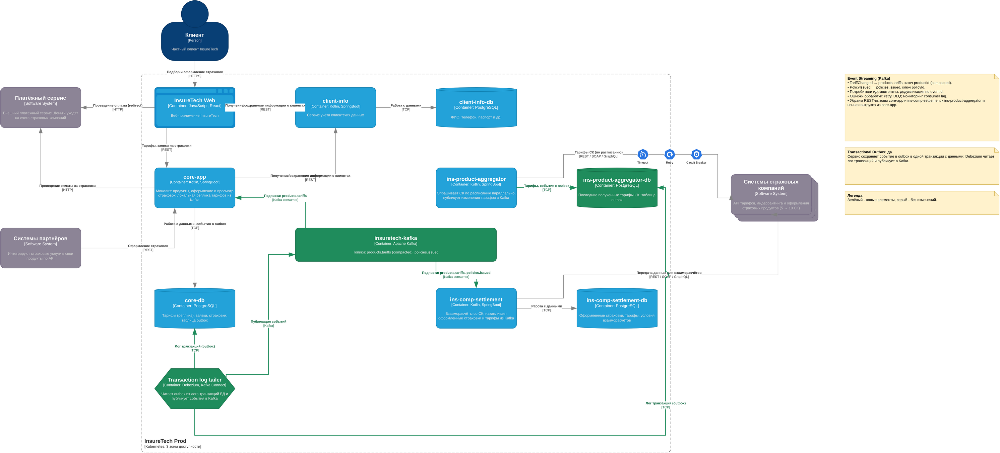

# Task3 - Переход на Event-Driven архитектуру

- [`problems-and-risks.md`](./problems-and-risks.md) - проблемы и риски
- [`InsureTech_C4_container-diagram_to-be.drawio`](./InsureTech_C4_container-diagram_to-be.drawio) - диаграмма контейнеров

Event Streaming: Kafka, события `TariffChanged` -> `products.tariffs`, `PolicyIssued` -> `policies.issued`.
Transactional Outbox: да (outbox -> Debezium -> Kafka), потребители идемпотентны (eventId).

