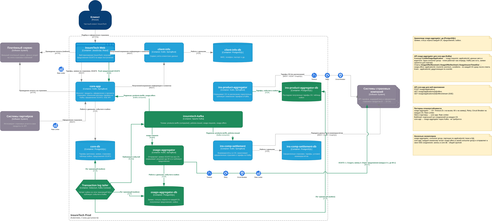

# Task4 - Проектирование продажи ОСАГО

- [`InsureTech_C4_container-diagram_osago.drawio`](./InsureTech_C4_container-diagram_osago.drawio) - диаграмма контейнеров

| Вопрос | Решение |
|---|---|
| Хранилище osago-aggregator | Да, PostgreSQL |
| API для core-app | Команда `CreateOsagoApplication` -> `osago.requests`; ответы `OsagoOfferReceived`, `OsagoOfferDeclined`, `OsagoInsurerTimedOut` -> `osago.offers` |
| Интеграция core-app - osago-aggregator | Kafka |
| API веб-приложения | `POST /osago/applications`, `GET /osago/applications/{id}/offers`, `GET /osago/applications/{id}/offers/stream` |
| Интеграция web - core-app | REST + SSE |
| Паттерны | osago-aggregator -> СК: Timeout, Retry, Circuit Breaker, Rate Limiter, Bulkhead; вход core-app: Rate Limiter |
| Несколько экземпляров | Партиции по applicationId, lease в БД; broadcast-подписка core-app на `osago.offers` |

